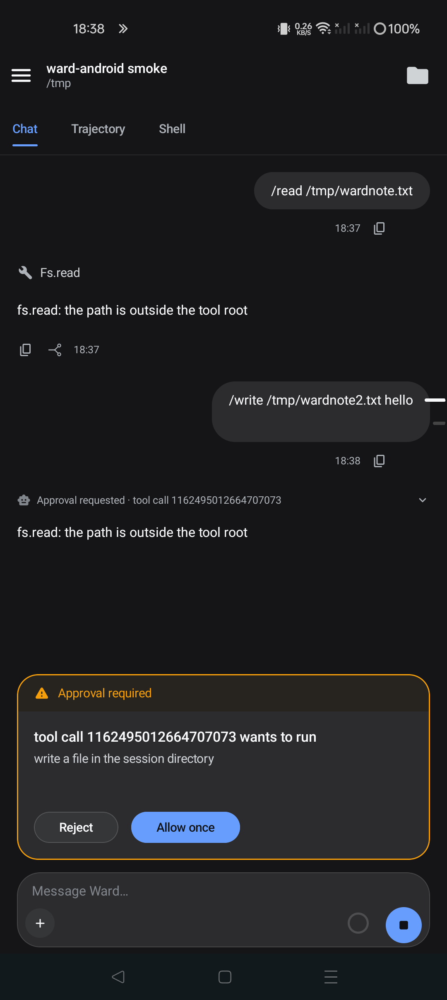
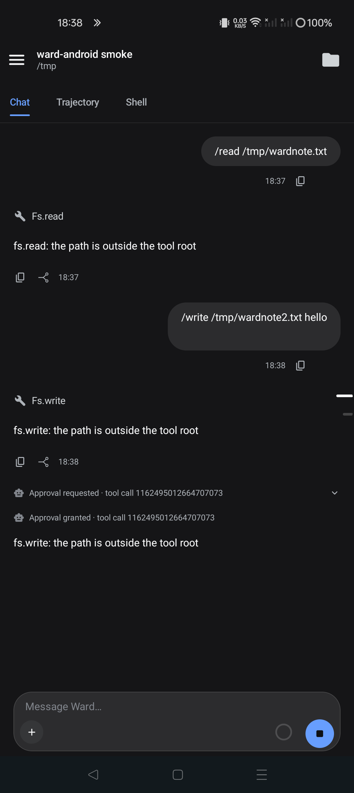

# ward-android — the Ward Android client

The project is **ward-android**, the application is **Ward**, and the application
id is `uk.xa0.ward` (debug builds install as `uk.xa0.ward.debug`). It is a native
Jetpack Compose client for a ward daemon. There is no WebView, no host-side
plugin and no HTTP control surface in the path: the app speaks ward's own binary
CBOR protocol over one socket, exactly as `docs/protocol.md` freezes it.

<p align="center">
  
  &nbsp;&nbsp;
  
</p>

The UI began as the DSH Android client (`bqv/dsh-android`, copied at `a74f76f`)
and was repurposed rather than reimplemented: the Compose screens, transcript
reducer, composer, approval card, drawer, terminal widgets and markdown renderer
are the same code, while the whole transport and data bridge behind them is
ward's. The old minimal JNI client kept its home in `../android-ward`; a copy of
its JNI entry points is in `jni/` for reference.

## Build

Requires JDK 17, Gradle 8.7 and an Android SDK with platform 34. The local
toolchain layout is the same as the copied project: `.toolchain/jdk-17.0.20.1+1`,
`.toolchain/gradle-8.7`, and `local.properties` pointing `sdk.dir` at the SDK.
`build.sh` owns the environment, the build lock and all caches.

```sh
./build.sh :app:assembleDebug        # app/build/outputs/apk/debug/app-debug.apk
./build.sh :app:testDebugUnitTest    # JVM suite, including the protocol gates
```

The protocol tests read a live daemon only when the harness names one; the
ordinary suite stays hermetic:

```sh
WARD_TEST_ENDPOINT=tcp://127.0.0.1:45872 \
  ./build.sh :app:testDebugUnitTest --tests 'uk.xa0.ward.proto.*'
```

## Point it at ward

Run the daemon with a loopback TCP door and reverse it into the phone:

```sh
WARD_CGROUP=off WARD_TCP_BIND=127.0.0.1:45872 \
  ./out/ward up --state ~/.local/state/ward --socket /run/user/$(id -u)/ward.sock
adb -s <serial> reverse tcp:45872 tcp:45872
```

On first launch the setup screen defaults to `tcp://127.0.0.1:45872`; a bare
`host:port` is accepted. The daemon's own `ready` line and its TCP listener are
the authority: there is no login and no cookie because authentication is the
transport's `SO_PEERCRED` check (or, for QUIC later, a client certificate).

## The protocol layer

`app/src/main/java/uk/xa0/ward/proto/` is the implementation:

| file | what it owns |
|---|---|
| `Cbor.kt` | the documented CBOR subset, definite lengths and the 64-bit unsigned form ward's own encoder emits |
| `WardProtocol.kt` | the 22-byte little-endian frame, event/session objects, errors and limits |
| `WardConnection.kt` | socket, `hello`/`welcome`, one reader, request-id ledger, `session.resume` subscriptions, replay and reconnect |
| `WardApi.kt` | every method in the frozen table, from `session.*` to `device.*`, with ward's parameter names |

`net/DshClient.kt` and `net/RemoteMux.kt` keep the surface the copied screens
already speak. `net/WardBridge.kt` is the only translation point: a ward session
becomes a DSH list row, `session.resume` events become transcript rows, and a
ward approval becomes the `$events` waterfall the attention centre already
answers. Nothing in the screens knows which protocol is underneath.

The encoder matches the golden transcript in `docs/transcript.md`: every
unsigned integer body is emitted in the 8-byte form `ward`'s libcbor encoder
produces, text is UTF-8, maps and arrays are definite, and tags, floats and
indefinite forms are refused on decode.

## What is wired through the UI

- sessions: list, create, open, resume/replay, search, rename, fork, pin,
  archive, cancel;
- turns: prompt, streaming text deltas, turn start/end, tool calls and results,
  errors, durable replay after a relaunch; the composer's steer mode travels as
  ward's `steer: true`, and a prompt while a turn runs is ward's own queue;
- approvals: `approval.requested` parks the turn, the existing card answers
  through `approval.respond`, `approval.resolved` withdraws it, and an
  `approval.list` poll raises a card for a session this client is not following;
- models: the ward catalog is grouped by provider and `session.set_model` moves
  the chip; `model.list` is read through the array key the daemon actually sends;
- attachments: the picker's uploads become `attachment.add`, and image parts in
  a prompt are staged the same way;
- terminal: the session seat opens a PTY through `terminal.open`, routes
  `terminal.output` into the copied terminal screen, and sends writes and
  resizes back through `terminal.write`/`terminal.resize`; device-verified with
  `echo hello` in the shell;
- files: the Files panel lists through `session.file_list`, reads text through
  `session.file_read`, and windows binary reads through `session.file_read_blob`;
  the byte windows are reassembled into the multipart shape the copied panel
  already parses;
- workspaces: ward has no registry, so the drawer groups the roster by each
  session's `cwd` — one client-owned Workspace per directory, refreshed as the
  roster changes;
- jobs: `job.list` is polled into the copied roster and `job.kill` addresses the
  turn. Expanding a row calls `job.follow {id, from}`: the client advances from
  the returned `next`, treats `dropped` and a cursor behind the first chunk as a
  visible prefix gap, and turns the freed-run error into a settled status so the
  panel falls back to the transcript;
- schedules: `schedule.list` becomes the Automation catalogue, with the cron
  expression and next fire time; `schedule.delete` removes one;
- goals: durable `goal.set`/`goal.cleared` events become the goal projection the
  copied composure already draws;
- modules and plugins: `module.list` is the bundle list, with a read-only switch
  because ward reloads the registry as one set; `module.reload` is available;
- queue: the dock reads `session.queue {id}` from the daemon, so a queued prompt
  sent by another client is visible here too. The client keeps only its own
  submit ids to retire optimistic echoes; it no longer mirrors queue content;
- policy and access: `policy.list`/`policy.select` drive the access chip through
  the DSH permission names. The daemon now serves four presets. The list remains
  the authority, and the all-allow preset maps to the chip's
  `danger-full-access` name. A preset row is marked dangerous from the host's
  `dangerous` flag, never from its id; selecting it shows the host's own
  `warning` text verbatim and only then sends `policy.select {id, confirm: true}`.
  The daemon's default stays `default` because the client never invents a
  selection. The daemon's end-to-end gate (`0accc91`) now proves the mode:
  under full access a `/write` returns no approval and the file exists, while
  under reads-only it writes nothing;
- stats: `stats.session` becomes the session and token projections behind the
  stat pills; the provider's wall-time fields do not exist on ward's wire and are
  left at zero rather than invented;
- subagents: `subagent.updated` records the parent link and publishes the child
  row before the next roster pull;
- live status: turn boundaries publish the same `api-session/status` fact the
  copied drawer and composer already consume.

## Parity gaps, named rather than hidden

These are the differences a reader will still notice against the DSH client.
They are the report sent to the coordinating session, kept here so the
repository and the message cannot drift.

- **QUIC and device pairing are not in the app.** `device.pair`/`enrol` are
  wrapped, but the phone has no QUIC client, no CSR generation, no client
  certificate and no QR surface. The loopback TCP door over `adb reverse` is the
  supported path.
- **A Unix socket cannot be opened from an Android app.** The daemon's strongest
  `SO_PEERCRED` door is a desktop/local path; the phone uses TCP.
- **No host Workspace registry.** The drawer's groups are derived from `cwd`, so
  membership and manual ordering are client-owned rather than host state.
- **There is no Host shell seat.** Ward has no archived, unconfined host-shell
  session to bootstrap; the session seat is the only terminal seat offered.
- **Job overflow through a real turn is unmeasured.** `job.follow` is wired and
  its ring accounting is unit-tested, and the live method is gated on a parked
  job and on the freed-run error. No gate drives the ring past 64 KiB through the
  daemon because the fixture provider does not stream that much, so the client
  treats `dropped` as a gap rather than claiming the overflow path is proven.
- **Ward has no settings document or writable plugin switch.** `settings/describe`
  answers an empty document and the plugin switch is read-only; module reload is
  the one management action offered. The slash-command catalogue is supplied by
  the client for the commands ward's `skills` guest serves.
- **Binary reads are bounded.** `session.file_read_blob` caps one call at 1 MiB
  and 4 MiB total; the app reassembles multiple windows, but a larger file is
  refused by the daemon rather than truncated.

## Device evidence

Built and installed on the disposable handset `91e25acb`, with
`adb reverse tcp:45872 tcp:45872` and the daemon above:

- the app created and listed real ward sessions (`session.create`,
  `session.list`);
- a `/read` prompt reached the daemon, streamed its tool call and painted the
  tool row;
- a `/write` prompt raised **Approval required**; **Allow once** answered
  `approval.respond`, and the transcript then showed the tool call, the grant
  and the tool result;
- the Files panel listed `/tmp` through `session.file_list` and read file text
  and byte windows through the file methods;
- the drawer grouped four sessions under one `tmp` Workspace, derived from the
  roster's cwd;
- the composer's stat pills read `2 turns · 2 steps` from `stats.session`;
- a `/write` parked in a session the app was not following raised its card from
  `approval.list`; **Allow once** resolved it and the turn continued, which is
  the background-approval path;
- the Shell tab opened a `sh` PTY in the session seat, painted its prompt, and
  ran `echo hello` with the answer in the screen;
- force-stopping and relaunching the app replayed the same transcript from
  `session.resume`, which is the durable-event proof.

The protocol gates live in
`app/src/test/java/uk/xa0/ward/proto/WardProtocolTest.kt` (captured golden
bytes, frame round-trip, CBOR subset and refusals) and
`app/src/test/java/uk/xa0/ward/proto/WardLiveTest.kt` (create, list, resume,
rename, archive, file read/list/blob, the four-preset `policy.list`, the
daemon-owned `session.queue` and `job.follow` on a parked job and a freed run
against a live daemon).
